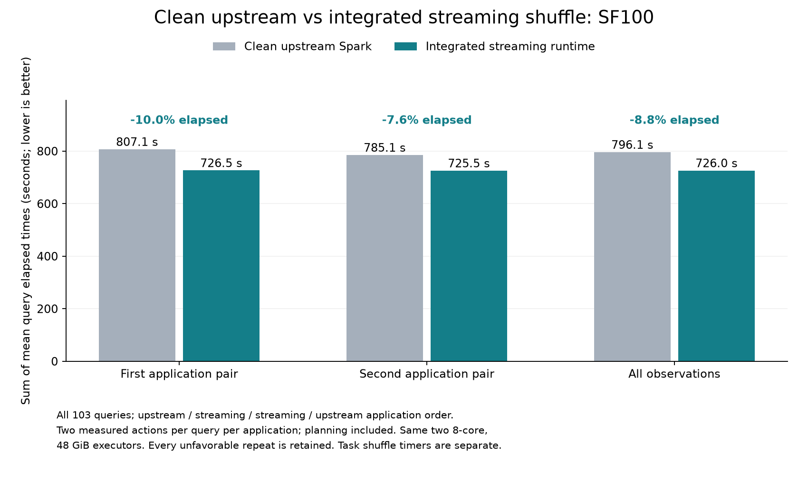

# Historical streaming shuffle benchmark

This chart records the previously validated frozen integrated runtime, not the
rebased and simplified code in PR #1. No new benchmark was run for the PR.

All 103 TPC-DS query variants at SF100 use one globally selected integrated runtime.
The control is unmodified upstream Spark at
`8e1f4f755337339a81602fccd644df87fca37cf5`. Application order is upstream /
streaming / streaming / upstream. Both use the same dedicated driver, two
eight-core workers with 48 GiB executor heaps, data, Java, dependencies, and common
settings. Each query has an initial checked answer, two warmups, and two measured
actions per application. Every measured repeat is retained.

| Observation | Upstream (s) | Frozen integrated runtime (s) | Change |
| --- | ---: | ---: | ---: |
| First pair | 807.100 | 726.488 | -9.99% |
| Second pair | 785.147 | 725.520 | -7.59% |
| Combined | 796.123 | 726.004 | -8.81% |

Times are sums of the 103 per-query mean elapsed times, including planning. They
are not end-to-end application runtimes or sums of concurrent task timers.

94 queries improve on average. q94 regresses 12.90% on average; q2, q15, q32, q37,
q81, q85, and q99 each regress over 5% in one pair. All unfavorable observations
remain included. Validation passed 2,060 answers, 679,662 event-log tasks, twelve
runtime audits, and 6,956 collected file hashes.

This is an integrated runtime result including planning, scheduling, sealed-memory
shuffle, and live transport effects. It does not isolate the benefit of streaming
transport. The current PR head requires a new benchmark before these results can
be attributed to it.
