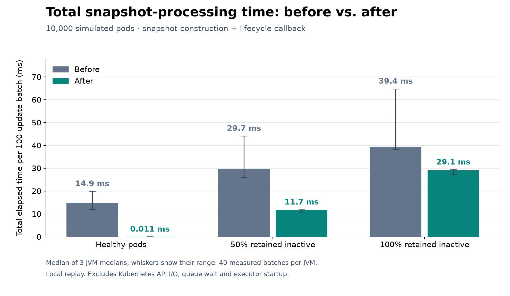
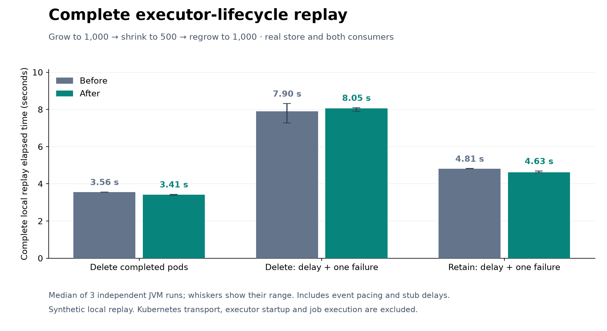

# Kubernetes lifecycle snapshot benchmark evidence

Supporting material for the lifecycle-index patch; not part of the Spark source diff.
Baseline: Apache Spark commit `203017c434785baf66fb6bb00805520c350cc6dc`.
The after version adds the lifecycle index and empty inactive-acknowledgement-set guard.

## Snapshot-processing measurement



10,000 simulated resident pods, 100 changed watch updates per batch. Time includes
incremental snapshot construction and the real lifecycle callback. Pod fixtures are
prepared outside timing. No API transport, executor startup, job execution or queue
wait is included. Inactive fixtures have no pending label acknowledgements.

Apple M5 Pro, 48 GiB RAM, macOS 26.4, JDK 17.0.20.1, fixed 1 GiB JVM heap.
Three independent JVMs per version/workload, at least 5 seconds and 20 batches of
warmup, then 40 measured batches. Plotted values are medians of per-JVM medians;
whiskers are their min/max, not confidence intervals. Versions were rotated.
`fix-samples.csv` includes baseline (`before`), index only (`indexed`), and final
index plus guard (`fixed`). The graph compares before and fixed. These are local
synthetic results, not a GitHub Actions benchmark or production performance claim.

## Whole-lifecycle checks



The real allocator and lifecycle manager subscribe to the real snapshots store.
Kubernetes API calls, executor feature building and the scheduler backend are mocked.
Four deterministic 32-pod scenarios compare action logs for deletion/retention,
with/without injected cleanup failure: all 411 baseline actions match, including
arguments and removal reasons, ignoring independent-pod ordering.

18 threaded runs (1,000 pods, three scenarios, two versions, three JVMs) all pass
final-state assertions. Traces grow, deliver healthy traffic/relist, shrink, repair
a missed watch event by relisting, reconcile a missing pod, retry cleanup, acknowledge
inactive labels, and regrow. Fault scenarios inject a 2 ms delete/patch delay and one
failed request. Both consumers poll at 201 ms; traffic pauses 2 ms every 16 updates.
A 1.1 second reconciliation pause and phase drains are included.

Whole-replay median elapsed times: normal delete 3.559 -> 3.415 seconds;
delayed delete 7.899 -> 8.053 seconds; delayed retention 4.809 -> 4.626 seconds.
The delayed-delete ranges overlap. These modest differences must not be described
as the isolated scan speedup translating into faster executor startup.
Index maintenance adds roughly 6-12 ms of producer work per full trace.
A separate deterministic backlog diagnostic estimates 6,889,920 -> 6,902,160 bytes
of reachable snapshot graphs (+0.18%), with equal peak outstanding counts of 1,617.
This sampled SizeEstimator result is not an exact peak-heap bound or leak test.

Batch-entry waits increased in retained-pod runs because batches grouped differently
around blocking stub calls. Two diagnostic pairs measured actual event-to-backend-
removal p95 at 1429 -> 1309 ms and 1388 -> 1332 ms. See waiting-time-review.md.
No real Kubernetes transport, throttling, executor startup, PVC reuse, multiple
resource profiles, production traces or long-running leak tests are covered.

## Reproduction

The Scala harness sources are included here to keep the proposed Spark diff small.
In separate disposable checkouts of baseline and the PR revision, copy the two Scala
files into `resource-managers/kubernetes/core/src/test/scala/org/apache/spark/scheduler/cluster/k8s/`.
Use JDK 17, then compile with:

```sh
build/sbt -Pkubernetes 'kubernetes/Test/compile' 'export kubernetes/Test/fullClasspath'
```

Use the exported colon-separated classpath as CP. For the closest reproduction,
compile the harness once and keep test bytecode/dependencies identical, replacing
only the Kubernetes production jar with the baseline or patched jar in CP. Ensure
CP does not also contain another version of Kubernetes production classes.
Run each workload in three fresh JVMs per version, rotating version order:

```sh
for scenario in running retained50 retained100; do
  SPARK_LOCAL_IP=127.0.0.1 java -Xms1g -Xmx1g \
    --add-exports=java.base/sun.nio.ch=ALL-UNNAMED \
    --add-opens=java.base/java.util=ALL-UNNAMED \
    --add-opens=java.base/java.lang=ALL-UNNAMED -cp "$CP" \
    org.apache.spark.scheduler.cluster.k8s.ExecutorPodsLifecycleBenchmark \
    "$scenario" 10000 5000 40 cpu
done
```

`SAMPLE` records build/process nanoseconds and allocated bytes. Sum build and process
for each sample, take the median per JVM, then the median across JVMs.
With the same Java flags and classpath, replay entry point is:
`org.apache.spark.scheduler.cluster.k8s.ExecutorPodsReplay <pods> <retain> <faults> <check|threaded> [memory]`.
Use 32 pods and all four boolean pairs for deterministic equivalence; compare ACTION
lines. Use 1000 pods and false/false, false/true, true/true for threaded checks (three
fresh JVMs each), and true/true check memory for the backlog diagnostic.

The committed regression suites were subsequently trimmed: 49 tests across snapshot,
lifecycle, store and allocator suites pass, as do production/test Scala style checks.
The archived harness contains broader supplemental validation, not extra committed tests.
